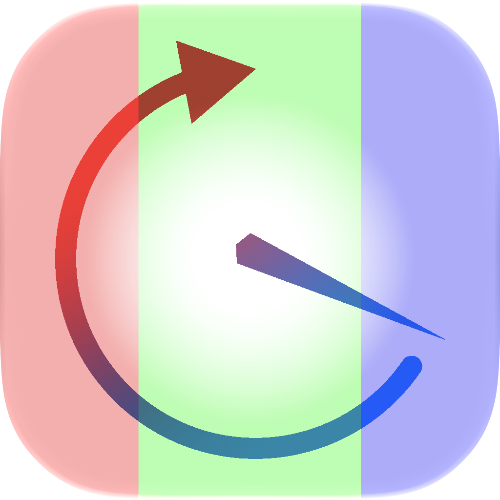

# IwashiCalibReminder



EIZO ColorEdgeの次回キャリブレーションまでの残り使用時間を表示する、macOSのメニューバーアプリです。現在のバージョンは **0.9** です。

## ダウンロード

[Releases](https://github.com/Yamonov/IwashiCalibReminder/releases)からZIPをダウンロードし、展開した `IwashiCalibReminder.app` を使用してください。配布アプリはDeveloper ID署名・Apple公証済みです。

## 対応環境と動作

- macOS Sonoma 14以降。Apple Silicon / IntelのUniversalバイナリ。
- 対象モニター: EIZO ColorEdge CS2731。モニターとのUSB接続が必要です。
- 残り時間の計算には、ColorNavigator 7に保存された調整記録と、使用時間による調整間隔が必要です。
- メニューバーの正方形グラフは、最短の残り使用時間に応じて緑・黄・赤へ変わります。100時間未満では整数時間、期限超過では「NG」を表示します。
- メニューから各モードの調整目標、前回の測定結果、使用時間、日時などを確認できます。
- 更新は起動時・1時間ごと・手動操作。通知時間は時間または日で指定します。1日はモニター使用時間の24時間です。
- ColorNavigatorの通常画面が開いている間は、モニターへ問い合わせません。メニューバーのAgentだけの場合は取得できます。
- CNのデータベースはSwiftで直接読み取り、モニター設定や元のDBは変更しません。

残り時間は、調整間隔から調整後のモニター使用時間を引いた値です。カレンダー上の経過時間ではありません。グラフの黄色は「（調整間隔 − 通知設定時間）÷3」以下、赤は通知設定時間以下で、赤を優先します。

## ビルド

動作確認済みの開発環境はXcode 27と[公式Swift 6.4.1ツールチェーン](https://www.swift.org/install/macos/)です。XcodeプロジェクトはツールチェーンID `org.swift.641202610071a` を選択します。Swift 6言語モード、完全な並行性チェック、コンパイラ警告のエラー化を有効にしています。

`IwashiCalibReminder.xcodeproj` を開き、`IwashiCalibReminder` スキームでビルドしてください。コマンドラインからは次のように実行できます。

```sh
xcodebuild -project IwashiCalibReminder.xcodeproj \
  -scheme IwashiCalibReminder -configuration Release \
  -derivedDataPath build/DerivedData build
```

生成先は `build/DerivedData/Build/Products/Release/IwashiCalibReminder.app` です。アプリをビルドするたびに `BuildMetadata/BuildNumber.xcconfig` のビルド番号が増加します。

公開プロジェクトの署名はローカル実行用のアドホック署名です。Developer ID署名や公証に必要な認証情報は、配布する開発者が別途設定してください。外部パッケージ・LevelDBライブラリ・Homebrewへの依存はありません。

## CLI

モニター情報を取得するCLIも共通ソースからビルドできます。

```sh
TOOLCHAINS=org.swift.641202610071a swift build -c release --product eizo-usage
.build/release/eizo-usage --help
```

このリポジトリには、アプリ・CLI・共通処理・アイコン・ビルド設定を収録しています。
